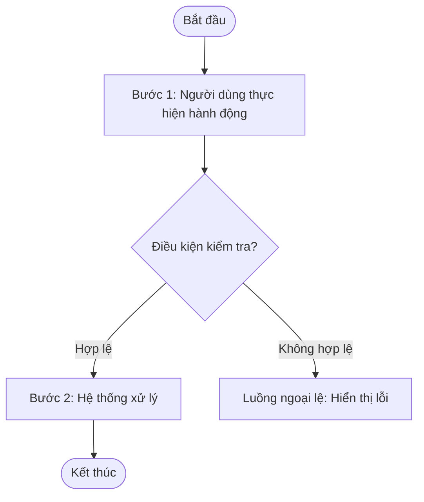

# SRS - [Tên module / chức năng]

---

## 1. Thông tin chung

| Mục | Nội dung |
|---|---|
| Mã SRS | `[Mã định danh tài liệu, ví dụ: SRS-PAR-001]` |
| Tên SRS | [Tên đầy đủ của module/chức năng] |
| Trạng thái | `Draft` / `In Review` / `Approved` |
| Người soạn | [Họ tên người soạn thảo] |
| Người duyệt | [Họ tên người duyệt] |
| Ghi chú | [Ghi chú bổ sung nếu có] |

### Lịch sử thay đổi

| Phiên bản | Ngày hiệu lực | Mô tả | Tham chiếu CR | Người thực hiện | Người duyệt |
|---|---|---|---|---|---|
| 1.0 | YYYY-MM-DD | Khởi tạo tài liệu | | [Họ tên] | |
| 1.1 | YYYY-MM-DD | Cập nhật tài liệu | [Mã CR liên quan] | [Họ tên] | [Họ tên] |

### Tài liệu tham chiếu

| STT | Tên tài liệu | Ghi chú |
|---|---|---|
| 1 | [Tên tài liệu tham chiếu] | [Mô tả / link] |

---

## 2. Giới thiệu

### 2.1 Mô tả

> Mô tả tổng quan mục đích của module/chức năng, phạm vi áp dụng và vai trò của nó trong hệ thống. Nêu rõ những gì người dùng có thể thực hiện thông qua module này.

[Module này cho phép người dùng nghiệp vụ:]

- [Chức năng chính 1]
- [Chức năng chính 2]
- [Chức năng chính 3]

[Mô tả thêm về vai trò, giá trị mang lại của module trong hệ thống tổng thể.]

### 2.2 Preconditions

> Liệt kê các điều kiện tiên quyết cần thỏa mãn trước khi người dùng sử dụng chức năng.

- [Điều kiện 1: ví dụ – Người dùng đã đăng nhập thành công]
- [Điều kiện 2: ví dụ – Người dùng có quyền truy cập hợp lệ]
- [Điều kiện 3: ví dụ – Hệ thống backend và database đang hoạt động bình thường]
- [Điều kiện 4: ví dụ – Dữ liệu nguồn đã được ghi nhận đầy đủ trên hệ thống]

### 2.3 Postconditions

> Liệt kê các kết quả/trạng thái hệ thống sau khi người dùng hoàn thành các thao tác trong module.

- [Kết quả 1: ví dụ – Dữ liệu được tạo/cập nhật lưu thành công vào CSDL]
- [Kết quả 2: ví dụ – Trạng thái bản ghi được cập nhật đúng theo luồng nghiệp vụ]
- [Kết quả 3: ví dụ – Dữ liệu hiển thị trên giao diện đồng bộ với backend]

---

## 3. Mô tả tổng quan hệ thống

### 3.1 Tác nhân tham gia

> Liệt kê tất cả tác nhân (actor) tương tác với chức năng và hệ thống, kèm mô tả vai trò và quyền hạn.

| Tác nhân | Mô tả vai trò / quyền hạn |
|---|---|
| [Tên tác nhân 1, ví dụ: Admin Portal] | [Mô tả quyền hạn và các thao tác tác nhân này được phép thực hiện] |
| [Tên tác nhân 2, ví dụ: Hệ thống Backend] | [Mô tả các xử lý tự động mà backend thực hiện] |
| [Tên tác nhân 3, ví dụ: Auth Service] | [Mô tả vai trò xác thực/phân quyền] |
| [Tên tác nhân 4, ví dụ: Database] | [Mô tả vai trò lưu trữ dữ liệu] |

### 3.2 Môi trường hoạt động

> Mô tả các ràng buộc và điều kiện về môi trường kỹ thuật mà hệ thống hoạt động.

- [Loại ứng dụng: ví dụ – Web application hỗ trợ thao tác trên giao diện quản trị]
- [Kích thước màn hình hỗ trợ (theo điều kiện: có tablet hoặc điện thoại): ví dụ – máy tính từ 1024px, tablet từ 768px tới dưới 1024px, điện thoại dưới 768px]
- [Cách người dùng truy cập: ví dụ – Truy cập qua menu X trên Portal]
- [Yêu cầu kết nối: ví dụ – Yêu cầu kết nối Internet ổn định]
- [Kiến trúc hệ thống: ví dụ – Mô hình client-server, frontend giao tiếp với backend qua API]
- [Múi giờ / thời gian: ví dụ – Thời gian hệ thống đồng bộ theo server time]

---

## 4. Sơ đồ luồng (Flow Diagram)

> Kịch bản thành công tiêu chuẩn (happy path).

> **Lưu ý:** Chỉ thêm diagram khi luồng có rẽ nhánh phức tạp. Xoá block mermaid nếu luồng đơn giản.

### Diễn giải

| Bước | Mô tả hành động | Kết quả hệ thống thực hiện |
|---|---|---|
| Bước 1 | [Người dùng thực hiện hành động gì] | [Hệ thống phản hồi ra sao] |
| Bước 2 | [Người dùng thực hiện hành động gì] | [Hệ thống phản hồi ra sao] |
| Bước 3 | [Người dùng thực hiện hành động gì] | [Hệ thống phản hồi ra sao] |

---

## 5. Yêu cầu giao diện (UI Requirements)

### Danh sách màn hình

| Mã | Tên màn hình | Chức năng chính | Tác nhân |
|---|---|---|---|
| SCR01 | [Tên màn hình 1] | [Mô tả chức năng chính của màn hình] | [Tên tác nhân] |
| SCR02 | [Tên màn hình 2] | [Mô tả chức năng chính của màn hình] | [Tên tác nhân] |

---

### 5.1 SCR01: [Tên màn hình]

#### 5.1.1 Ảnh design/mockup

> [Đính kèm ảnh màn hình hoặc link Figma/mockup tại đây]

#### 5.1.2 Thành phần giao diện

**Trường thông tin *(Của màn hình, chức năng)***

| Tên trường | Loại | Giá trị mặc định | Bắt buộc | Quy tắc nhập |
|---|---|---|---|---|
| [Tên trường, ví dụ: Từ ngày] | [Loại input: Date picker / Textbox / Dropdown / ...] [Textbox và các ô nhập liệu khác luôn thêm giới hạn  min maxlength vào sau. Ví dụ: Textbox (1-255 ký tự)] | [Rỗng / Giá trị mặc định] | Có / Không | [Mô tả rule validate và logic nghiệp vụ của trường] [với mỗi giá trị hoặc có 2 vấn đề trở lên thì thêm thẻ br. Ví dụ: Các giá trị: - Sắp diễn ra:[Mô tả ý nghĩa của giá trị] - Đang diễn ra:[Mô tả ý nghĩa của giá trị]...] |
| [Tên trường, ví dụ: Trạng thái] | Dropdown | Tất cả | Không | [Danh sách giá trị hợp lệ và mô tả cho từng giá trị tương ứng] ví dụ:  - Đang diễn ra: Lọc các cuộc đấu theo trạng thái đang trong thời gian đấu giá - Đã kết thúc: Lọc các cuộc đấu đã hết thời gian đấu giá|
>Textbox và các ô nhập liệu khác luôn thêm giới hạn  min maxlength vào sau. Ví dụ: Textbox (1-255 ký tự).
>Ở phần quy tắc nhập với mỗi giá trị hoặc có 2 vấn đề trở lên thì thêm thẻ  . Ví dụ: Các giá trị: Sắp diễn ra:[Mô tả ý nghĩa của giá trị] Đang diễn ra:[Mô tả ý nghĩa của giá trị]...
>Loại input luôn viết bằng tiếng Anh.

**Trường thông tin chính** *(nếu có - áp dụng cho màn hình tạo mới/chỉnh sửa)*

| Tên trường | Loại | Giá trị mặc định | Bắt buộc | Quy tắc nhập |
|---|---|---|---|---|
| [Tên trường] | [Loại] | [Mặc định] | Có | [Mô tả rule] |

**Nút chức năng**

| Tên nút | Mô tả |
|---|---|
| [Tên nút, ví dụ: Tìm kiếm] | [Hành vi khi bấm nút: validate gì, điều hướng đi đâu] |
| [Tên nút, ví dụ: Làm mới] | [Hành vi khi bấm nút] |

**Bảng biểu** *(bảng danh sách - nếu có)*

| Tên cột | Mô tả |
|---|---|
| STT | Số thứ tự dòng dữ liệu |
| [Tên cột 1] | [Mô tả dữ liệu hiển thị trong cột này] |
| [Tên cột 2] | [Mô tả dữ liệu hiển thị trong cột này] |
| Thao tác | [Mô tả các action button theo từng dòng] |

#### 5.1.3 Business Rules

> Liệt kê các quy tắc nghiệp vụ áp dụng cho màn hình này và các trường thông tin tương ứng nếu có.

| Mã | Nội dung | Mô tả | Loại |
|:---|:---|:---|:---|
| BR01 | [Tên ngắn của quy tắc, ví dụ: Thứ tự danh sách] | [Quy tắc chỉ có một ý thì viết một câu. Ví dụ: Danh sách mặc định xếp theo thời gian tạo, mới nhất ở trên.] | Logic |
| BR02 | [Ví dụ quy tắc nhiều ý: Ưu tiên bài được ghim] | - Bài ghim phải đứng trước bài chưa ghim. Bài ghim sau phải đứng trước bài ghim trước. - Bài ghim được tính vào định mức của nhóm tổ chức đăng bài. - Số bài ghim của một nhóm vượt định mức của nhóm đó: vẫn phải lấy đủ bài ghim, nhóm kia nhận phần còn lại. - Lý do: bài ghim là lựa chọn của Admin nên được ưu tiên hơn tỷ lệ. | Logic |
| BR03 | [Ví dụ quy tắc có danh sách con: Mức cảnh báo hạn đăng ký] | - Mức cảnh báo được xác định theo thời gian còn lại tới hạn đăng ký: &nbsp;&nbsp;+ Dưới 24 giờ: Khẩn &nbsp;&nbsp;+ Từ 24 giờ tới dưới 72 giờ: Sắp hết hạn &nbsp;&nbsp;+ Từ 72 giờ trở lên: Bình thường - Bản ghi hết hạn trong lúc người dùng đang xem phải được giữ tới lần tải trang kế tiếp, sau đó phải bị loại khỏi danh sách. - Lý do: người dùng phải nhận ra ngay bản ghi sắp hết hạn. (Màu của từng mức ghi ở bảng giao diện.) | Logic |

> Cột Loại chỉ nhận một trong năm giá trị: Chính sách, Dữ liệu (định nghĩa, nguồn, tiêu chí chọn), Ràng buộc, Tính toán, Logic. Quy tắc không xếp được vào loại nào thì đó là giao diện (đưa lên bảng giao diện) hoặc kỹ thuật (đưa sang Yêu cầu phi chức năng).
>
> Cách viết cột Mô tả:
> - Quy tắc một ý: viết một câu, không gạch đầu dòng.
> - Quy tắc từ hai ý trở lên: mỗi ý một gạch đầu dòng, các ý nối bằng thẻ ` `. Mỗi ý là một câu ngắn, dạng "Điều kiện: kết quả".
> - Ý có danh sách con (ngưỡng, giá trị, các trường hợp): dòng con bắt đầu bằng `&nbsp;&nbsp;+ `.
> - Lý do nghiệp vụ, nếu có, đặt ở gạch đầu dòng cuối, bắt đầu bằng "Lý do:".
> - Viết dạng quy tắc bắt buộc, dùng "Phải", "Chỉ được phép", "Không được". Không kể lại luồng thao tác.
> - BR chỉ nói về dữ liệu và chính sách. Không gọi tên thành phần giao diện (khu, tab, nút, màu, bố cục). Gọi theo loại dữ liệu, ví dụ "danh sách cuộc đấu hệ thống tự chọn để giới thiệu". Hành vi giao diện (hiệu ứng, con trỏ, khóa nút, chữ hiển thị) viết ở bảng giao diện.
> - BR chỉ viết phần bảng giao diện chưa nói: điều kiện, cách chọn và sắp xếp dữ liệu, quy đổi dữ liệu sang hiển thị, hệ quả về dữ liệu. Chữ hiển thị, định dạng, số thẻ viết ở bảng giao diện.

---

### 5.2 SCR02: [Tên màn hình]

#### 5.2.1 Ảnh design/mockup

> [Đính kèm ảnh màn hình hoặc link Figma/mockup tại đây]

#### 5.2.2 Thành phần giao diện

**Trường thông tin popup/form**

| Tên trường | Loại | Giá trị mặc định | Bắt buộc | Enable/Disable | Mô tả |
|---|---|---|---|---|---|
| [Tên trường] | [Loại] | [Mặc định] | Có / Không | Enable / Disable | [Mô tả chi tiết rule và logic] |

**Nút chức năng**

| Tên nút | Mô tả |
|---|---|
| [Tên nút] | [Hành vi] |

**Bảng biểu preview** *(nếu có)*

| Tên cột | Mô tả |
|---|---|
| STT | Số thứ tự dòng |
| [Tên cột] | [Mô tả] |

#### 5.2.3 Business Rules

| Mã | Nội dung | Mô tả | Loại |
|:---|:---|:---|:---|
| BR06 | [Tên ngắn] | [Mô tả, cách viết như mục 5.1.3] | [Loại] |
| BR07 | [Tên ngắn] | [Mô tả] | [Loại] |

### 5.X SCRXX: Giao diện theo kích thước màn hình (theo điều kiện: màn có bản tablet hoặc điện thoại)

> Business Rules, dữ liệu, API, phân quyền viết một lần ở các mục trên. Mục này chỉ ghi phần giao diện và tương tác khác nhau. Không chép lại bảng thành phần của bản máy tính. Xem `_chung/da-nen-tang.md`.

**Thiết kế:** [link thiết kế bản máy tính], [link thiết kế bản tablet], [link thiết kế bản điện thoại], ghi tên board.

**Breakpoint**

| Bản | Chiều rộng áp dụng | Thiết kế chuẩn |
|:---|:---|:---|
| Máy tính | [từ ...px] | [...px] |
| Tablet | [từ ...px tới dưới ...px] | [...px] |
| Điện thoại | [dưới ...px] | [...px] |

**Hành vi thành phần** (chỉ ghi thành phần có khác biệt)

| Thành phần | Máy tính | Tablet | Điện thoại |
|:---|:---|:---|:---|
| [Tên thành phần] | [Cách hiển thị và thao tác: hover, bảng nhiều cột...] | [Ẩn, hiện, co giãn, chạm, vuốt...] | [Chuyển dạng thẻ, ẩn cột phụ...] |

---

## 6. Mô tả usecase

### Danh sách usecase

| Mã | Tên Use Case | Mô tả | Mã màn hình liên quan |
|---|---|---|---|
| UC-[PREFIX]-01 | [Tên usecase 1] | [Mô tả ngắn gọn mục đích của usecase] | SCR01 |
| UC-[PREFIX]-02 | [Tên usecase 2] | [Mô tả ngắn gọn mục đích của usecase] | SCR02 |

---

### 6.X UC-[PREFIX]-XX: [Tên usecase]

| **Usecase ID** | UC-[PREFIX]-XX |
|:---|:---|
| **Tên usecase** | [Tên đầy đủ của usecase, dạng Động từ + Danh từ. VD: "Đăng nhập hệ thống"] |
| **Mô tả** | [Mô tả ngắn gọn mục đích, ý nghĩa nghiệp vụ của usecase này] |
| **Tác nhân** | **Chính:** [Tác nhân chính thực hiện usecase] **Phụ:** [Tác nhân/hệ thống phụ tham gia, nếu có] |
| **Tiền điều kiện** | [Điều kiện phải đúng trước khi usecase bắt đầu] [Có thể có nhiều điều kiện, đánh số 1, 2... và phân các mỗi bước bằng thẻ br] |
| **Luồng chính** | 1. [Bước 1: Mô tả hành động của actor] 2. [Bước 2: Mô tả phản hồi/xử lý của hệ thống] 3. [Bước 3: Mô tả hành động tiếp theo của actor] 4. [Bước 4: Hệ thống xử lý và trả kết quả] 5. [Bước 5: ...] **Kết thúc** |
| **Luồng thay thế** | **[Mã bước].[STT]** [Điều kiện rẽ nhánh hợp lệ tại bước đó] → [Hệ thống/actor xử lý thế nào] → [Quay lại bước nào, hoặc chuyển sang UC khác]  **[Mã bước].[STT]** [Điều kiện rẽ nhánh khác] → [Xử lý] |
| **Luồng ngoại lệ** | **[Mã bước].[STT]** [Điều kiện lỗi/ngoại lệ phát sinh tại bước đó, có thể tham chiếu Business Rule] → [Hệ thống xử lý/thông báo lỗi như thế nào] → [Quay lại bước nào]  **[Mã bước].[STT]** [Điều kiện lỗi khác] → [Xử lý] |

---

### Hướng dẫn sử dụng template (xóa phần này khi áp dụng thực tế)

- **Luồng chính**: chỉ mô tả hành động/phản hồi theo thứ tự, KHÔNG nhúng chi tiết validate/format vào đây.
- **Luồng ngoại lệ / Luồng thay thế**: đánh số theo **[số bước trong Luồng chính].[số thứ tự ngoại lệ tại bước đó]**. VD: ngoại lệ thứ 1 phát sinh tại bước 5 → đánh số **5.1**; ngoại lệ thứ 2 cũng tại bước 5 → **5.2**.
  - **Luồng thay thế**: rẽ nhánh nhưng vẫn dẫn đến kết quả hợp lệ (VD: đăng nhập bằng mạng xã hội thay vì username/password).
  - **Luồng ngoại lệ**: rẽ nhánh do lỗi/dữ liệu không hợp lệ/hệ thống gặp sự cố.

---

## 7. Yêu cầu phi chức năng

> Liệt kê các yêu cầu về hiệu năng, bảo mật, khả năng sử dụng và các ràng buộc kỹ thuật khác.

| ID | Mô tả | Ghi chú |
|---|---|---|
| NFR-01 | [Mô tả yêu cầu về hiệu năng, ví dụ: Thời gian tải màn hình không vượt quá X giây] | [Điều kiện áp dụng] |
| NFR-02 | [Mô tả yêu cầu về bảo mật, ví dụ: Hệ thống chỉ hiển thị dữ liệu đúng với quyền được phân] | [Phạm vi áp dụng] |
| NFR-03 | [Mô tả yêu cầu về tính nhất quán dữ liệu] | [Phạm vi áp dụng] |
| NFR-04 | [Mô tả yêu cầu về audit log / truy vết] | [Phạm vi áp dụng] |
| NFR-05 | [Mô tả yêu cầu về trình duyệt / nền tảng hỗ trợ] | [Phạm vi áp dụng] |

---

## 8. Ràng buộc và giả định

### 8.1 Ràng buộc

> Liệt kê các ràng buộc cứng mà hệ thống bắt buộc phải tuân thủ, bao gồm ràng buộc dữ liệu, nghiệp vụ và kỹ thuật.

- [Ràng buộc 1 – ràng buộc về tính duy nhất dữ liệu, ví dụ: Mỗi bản ghi chỉ được thuộc về duy nhất 01 đối tượng cha tại cùng một thời điểm]
  - [Chi tiết trường hợp xử lý tranh chấp nếu có]
  - [Điều kiện không cho phép trùng lặp]
- [Ràng buộc 2 – điều kiện lọc dữ liệu đầu vào, ví dụ: Hệ thống chỉ lấy vào các bản ghi thỏa đồng thời các điều kiện nghiệp vụ]
  - [Điều kiện 1]
  - [Điều kiện 2]
  - [Điều kiện 3]
- [Ràng buộc 3 – kiểm tra tính nhất quán tại thời điểm lưu, ví dụ: Hệ thống phải kiểm tra lại dữ liệu khi lưu để tránh lệch giữa preview và thực tế]
- [Ràng buộc 4 – về tập giá trị trạng thái hợp lệ, ví dụ: Trạng thái chỉ được cập nhật trong tập giá trị đã định nghĩa]
- [Ràng buộc 5 – về audit log, ví dụ: Hệ thống phải ghi nhận đầy đủ lịch sử thao tác cho các hành động quan trọng]
- [Ràng buộc 6 – về đồng bộ dữ liệu, ví dụ: Dữ liệu hiển thị trên giao diện phải đồng bộ với dữ liệu thực tế từ backend]
- [Ràng buộc 7 – về phạm vi chức năng, ví dụ: Chức năng này chỉ phục vụ nghiệp vụ X, không thay thế cho module Y]

### 8.2 Giả định

> Liệt kê các giả định đã được chấp nhận khi thiết kế, nếu giả định sai thì yêu cầu cần xem xét lại.

- [Giả định 1 – về người dùng, ví dụ: Người dùng đã được cấp tài khoản hợp lệ và được phân quyền phù hợp]
- [Giả định 2 – về dữ liệu nguồn, ví dụ: Dữ liệu từ hệ thống nguồn đã tồn tại sẵn và có thể truy xuất tại thời điểm thao tác]
- [Giả định 3 – về cách hệ thống hiểu khoảng thời gian, ví dụ: Khoảng thời gian nhập vào được hiểu là lọc theo trường X, không phải theo ngày tạo hay ngày Y]
- [Giả định 4 – về cách xác định dữ liệu tự động, ví dụ: Hệ thống tự xác định danh sách theo rule, người dùng không chọn tay từng bản ghi]
- [Giả định 5 – về bước bắt buộc trong luồng, ví dụ: Bước kiểm tra dữ liệu trước khi lưu là bắt buộc trong nghiệp vụ tạo mới/chỉnh sửa]
- [Giả định 6 – về xử lý khi dữ liệu nguồn thay đổi, ví dụ: Backend có quyền từ chối lưu nếu dữ liệu nguồn thay đổi giữa thời điểm kiểm tra và lưu]
- [Giả định 7 – về ý nghĩa của tên/nhãn nghiệp vụ, ví dụ: Tên bản ghi chỉ phục vụ nhận diện, không có ràng buộc duy nhất trừ khi được quy định rõ]
- [Giả định 8 – về phạm vi màn hình, ví dụ: Màn hình chi tiết chỉ phục vụ tra cứu; nghiệp vụ sâu hơn ở cấp con sẽ được đặc tả ở tài liệu khác]

---

## 9. Tiêu chí chấp nhận (Acceptance Criteria)

Mỗi AC mô tả một kịch bản kiểm thử cụ thể với điều kiện đầu vào và kết quả kỳ vọng. List đầy đủ các AC trong màn hình/chức năng. Đặt tên AC theo mã màn hình hoặc usecase liên quan để dễ trace.

### 9.1 Ma trận phạm vi bao phủ (Coverage Checklist)

> ⚠️ **LƯU Ý QUAN TRỌNG KHI GEN:** Mục 9.1 này là **bước rà soát nội bộ** (working checklist) — dùng để tự kiểm tra đã bao phủ đủ các nhóm case chưa **trước khi viết bảng AC**, giống như một danh sách nháp trong đầu. **Không in/gen lại nội dung mục 9.1 ra tài liệu kết quả.** Output cuối cùng đưa cho người dùng **chỉ gồm bảng ở mục 9.2** — không kèm checklist này.
>
> Cách dùng: với mỗi màn hình/usecase trong SRS, âm thầm rà qua từng nhóm A→P bên dưới; nếu SRS có nội dung tương ứng, đảm bảo sinh ra ít nhất 1 dòng AC trong bảng 9.2. Nếu SRS không đề cập nội dung nào trong một nhóm (ví dụ không có phân trang, không có export…) → bỏ qua nhóm đó, **không tự phát sinh thêm rule** không có trong tài liệu.

**A. Hiển thị & dữ liệu**
- [ ] Hiển thị đúng và đủ khi có dữ liệu (đủ cột/trường theo mô tả UI)
- [ ] Hiển thị khi danh sách/dữ liệu rỗng (empty state), đúng nội dung thông báo, không lỗi giao diện
- [ ] Hiển thị khi dữ liệu thiếu/null ở một số trường không bắt buộc (ví dụ hiển thị "—")
- [ ] Định dạng hiển thị đặc thù (mask/không mask, viết hoa, đơn vị, làm tròn số…) đúng theo quyết định đã chốt trong SRS

**B. Validate từng trường nhập liệu (lặp lại cho MỖI trường bắt buộc/có rule riêng)**
- [ ] Để trống → đúng thông báo lỗi tại đúng trường
- [ ] Chỉ nhập khoảng trắng (nếu có yêu cầu trim) → coi như rỗng, đúng thông báo lỗi
- [ ] Sai định dạng/kiểu dữ liệu riêng của trường (số, email, độ dài min–max, ký tự cho phép…) nếu SRS có quy định
- [ ] Nhập đúng biên (boundary): tối thiểu, tối đa ký tự/giá trị cho phép
- [ ] Nhập hợp lệ → được chấp nhận, không báo lỗi

**C. Luồng thao tác chính (happy path) của mỗi hành động CRUD/nghiệp vụ**
- [ ] Tạo mới thành công — đúng vị trí bản ghi mới trong danh sách (đầu/cuối), đúng toast
- [ ] Cập nhật thành công — dữ liệu phản ánh đúng, đúng toast
- [ ] Xoá thành công — bản ghi biến mất đúng chỗ, đúng toast
- [ ] Các hành động nghiệp vụ đặc thù khác nếu có (duyệt, huỷ, đổi trạng thái, gán, chuyển…)

**D. Luồng lỗi hệ thống/backend**
- [ ] Lỗi gọi API khi tải danh sách → thông báo lỗi, không hiển thị dữ liệu cũ gây hiểu nhầm
- [ ] Lỗi gọi API khi Tạo/Sửa/Xoá → thông báo lỗi chung, giữ nguyên dữ liệu form, không đóng popup, không thay đổi dữ liệu hiển thị

**E. Luồng huỷ/thoát**
- [ ] Bấm Hủy/Đóng popup khi đang nhập dở → không lưu, dữ liệu gốc không đổi
- [ ] Bấm Hủy bỏ ở popup xác nhận (nếu có) → không thực hiện hành động, quay lại màn trước

**F. Business Rules (BR) nêu trong SRS**
- [ ] Mỗi mã BR trong SRS có tối thiểu 1 AC trích dẫn lại đúng mã BR tương ứng
- [ ] Các ràng buộc/giới hạn đã "chốt phạm vi" (ví dụ: không giới hạn ký tự, xoá tự do không ràng buộc…) có AC xác nhận đúng hành vi KHÔNG bị chặn, tránh hiểu nhầm là thiếu sót

**G. Phân quyền & bảo mật**
- [ ] Người dùng có quyền → thấy/thao tác được đúng chức năng
- [ ] Người dùng không có quyền → ẩn hoặc disable đúng menu/nút tương ứng, không thao tác được kể cả gọi API trực tiếp (nếu SRS có đề cập)

**H. Cô lập dữ liệu / đa tổ chức (multi-tenant, nếu có)**
- [ ] Mỗi tổ chức/tenant chỉ thấy đúng dữ liệu của mình, không thấy chéo dữ liệu tổ chức khác

**I. Danh sách: phân trang / sắp xếp / tìm kiếm / lọc (nếu có)**
- [ ] Phân trang đúng số bản ghi, chuyển trang không mất dữ liệu
- [ ] Đổi số bản ghi/trang cập nhật đúng bảng
- [ ] Sắp xếp/tìm kiếm/lọc trả đúng kết quả, kể cả khi không có kết quả phù hợp

**J. Hành vi phụ (copy, export, clipboard, tooltip, preview…)**
- [ ] Hành vi phụ hoạt động đúng điều kiện hiển thị (cờ điều kiện, quyền, trạng thái dữ liệu)
- [ ] Trường hợp hành vi phụ thất bại (ví dụ trình duyệt không hỗ trợ Clipboard API) → có thông báo lỗi tương ứng, không báo thành công giả

**K. Trạng thái & chuyển đổi trạng thái (nếu đối tượng có field trạng thái)**
- [ ] Giá trị mặc định đúng khi tạo mới
- [ ] Chuyển đổi trạng thái được lưu đúng, phản ánh đúng ở nơi sử dụng dữ liệu này (nếu SRS đề cập)

**L. Ràng buộc dữ liệu liên quan / hệ quả liên module (nếu có)**
- [ ] Hành động ảnh hưởng đến dữ liệu tham chiếu ở module khác → đúng theo hành vi đã chốt (chặn hoặc không chặn), không tự suy diễn thêm điều kiện ràng buộc nếu SRS đã nói rõ là không ràng buộc

**M. Nội dung thông báo (Message/Toast)**
- [ ] Toast/lỗi thành công/thất bại đúng NGUYÊN VĂN nội dung trong SRS (không diễn giải lại)
- [ ] Đúng thời gian tự ẩn nếu SRS có quy định (ví dụ ~2.5 giây)
- [ ] Đúng loại severity (success/error/warning) nếu SRS có phân biệt

**N. Thao tác trùng lặp / đồng thời (nếu có rủi ro)**
- [ ] Bấm Lưu nhiều lần liên tiếp (double-submit) không tạo trùng bản ghi, nếu SRS/thiết kế có xử lý
- [ ] Hai người dùng cùng thao tác trên một bản ghi (nếu SRS có đề cập hành vi mong đợi)

**O. Phi chức năng liên quan trực tiếp đến trải nghiệm màn hình (nếu SRS có nêu ở mục NFR)**
- [ ] Thời gian phản hồi/tải trang trong ngưỡng cho phép
- [ ] Trình duyệt/thiết bị hỗ trợ đúng danh sách đã nêu
- [ ] Audit log được ghi nhận cho thao tác thay đổi dữ liệu (nếu SRS yêu cầu)

**P. Phạm vi đã chốt / ngoài phạm vi**
- [ ] Có AC xác nhận rõ các hành vi "đã chốt không làm" (ví dụ: không có tìm kiếm, không giới hạn ký tự…) để tránh bị hiểu nhầm là thiếu sót khi review/test

---

### 9.2 Bảng Acceptance Criteria

> ⚠️ Đây là phần **duy nhất được gen ra output**. Tiêu đề cột bên dưới giữ nguyên như trong bảng — phần giải thích cách điền từng cột nằm ở "Ghi chú cột" ngay sau bảng, **không đưa các chú thích đó vào tên cột**.

| ID | Tiêu chí | Mô tả kiểm thử | Message/Toast | Liên kết |
|---|---|---|---|---|
| AC-[PREFIX]-01 | Hiển thị danh sách bản ghi | Truy cập màn hình khi có dữ liệu → hệ thống hiển thị đúng và đủ danh sách theo mô tả UI | | UC-xx / SCR-xx |
| AC-[PREFIX]-02 | Hiển thị danh sách rỗng khi chưa có dữ liệu | Khi chưa có dữ liệu nào → hệ thống hiển thị empty state, không lỗi giao diện | "Chưa có bản ghi nào." | UC-xx |
| AC-[PREFIX]-03 | Validate bắt buộc nhập khi tạo mới | Để trống trường bắt buộc → bấm Lưu → hệ thống hiển thị đúng thông báo validate tại trường, không lưu | "Vui lòng nhập {tên trường}." | BR-xx |
| AC-[PREFIX]-04 | Validate dữ liệu không hợp lệ | Nhập dữ liệu vi phạm rule (sai định dạng/ký tự không cho phép) → hệ thống hiển thị thông báo lỗi và không thực hiện thao tác | "{Nội dung lỗi cụ thể}" | BR-xx |
| AC-[PREFIX]-05 | Tạo mới thành công | Nhập đầy đủ và hợp lệ → bấm Lưu → hệ thống lưu thành công, hiển thị thông báo và cập nhật lại danh sách | "Đã tạo {tên bản ghi} "{giá trị}"." | UC-xx, BR-xx |
| AC-[PREFIX]-06 | Chỉnh sửa thành công | Cập nhật thông tin hợp lệ → bấm Lưu → hệ thống lưu đúng và phản ánh lại trên giao diện | "Đã cập nhật {tên bản ghi} "{giá trị}"." | UC-xx, BR-xx |
| AC-[PREFIX]-07 | Cập nhật trạng thái thành công | Chọn trạng thái mới hợp lệ → bấm cập nhật → hệ thống lưu và hiển thị đúng trạng thái mới | "Đã cập nhật." | UC-xx |

**Ghi chú cột (chỉ để hiểu cách điền — không đưa các dòng ghi chú này vào output):**
- **Tiêu chí**: tên ngắn gọn của kịch bản kiểm thử.
- **Mô tả kiểm thử**: diễn đạt theo cấu trúc *Điều kiện đầu vào → Kết quả kỳ vọng*, không mô tả rời rạc.
- **Message/Toast**: chỉ điền khi hành động có toast/thông báo lỗi cụ thể trong SRS, trích nguyên văn; **để ô trống** (không ghi "Không có" hay "N/A") nếu AC đó không phát sinh message.
- **Liên kết**: mã UC/BR/SCR liên quan trong SRS nếu có, giúp trace ngược; **để ô trống** nếu AC không gắn với mã cụ thể nào.

---

## Hướng dẫn sử dụng khi gen AC cho một SRS cụ thể

1. Đọc toàn bộ SRS, liệt kê danh sách: các màn hình (SCR), usecase (UC), business rules (BR).
2. Âm thầm rà theo từng nhóm trong **Coverage Checklist (9.1)** như một bước kiểm tra nội bộ — đối chiếu xem SRS có nội dung tương ứng không, nếu có thì đảm bảo sẽ sinh ra ít nhất 1 dòng AC cho nhóm đó.
3. Viết **bảng AC ở mục 9.2** theo đúng 5 cột: ID, Tiêu chí, Mô tả kiểm thử, Message/Toast, Liên kết — đặt ID theo prefix của SRS (ví dụ AC-BANK-XX).
4. **Output cuối cùng gửi cho người dùng chỉ gồm bảng ở bước 3** — không in lại nội dung Coverage Checklist (9.1), không giải thích quá trình rà soát.
5. Không tự thêm rule/giả định ngoài SRS. Nếu phát hiện SRS thiếu thông tin để viết AC đầy đủ (ví dụ chưa nêu rõ thông báo lỗi), ghi chú "cần bổ sung" thay vì tự bịa nội dung.
6. Rà lại trước khi gửi: mỗi BR trong SRS phải xuất hiện tối thiểu 1 lần ở cột Liên kết của bảng AC — nếu thiếu, bổ sung AC còn sót.

----
**Yêu cầu bắt buộc**
- Trước khi hoàn thành, rà soát lại để đảm bảo đủ các tiêu chí, các note đã được đề cập và nhấn mạnh.